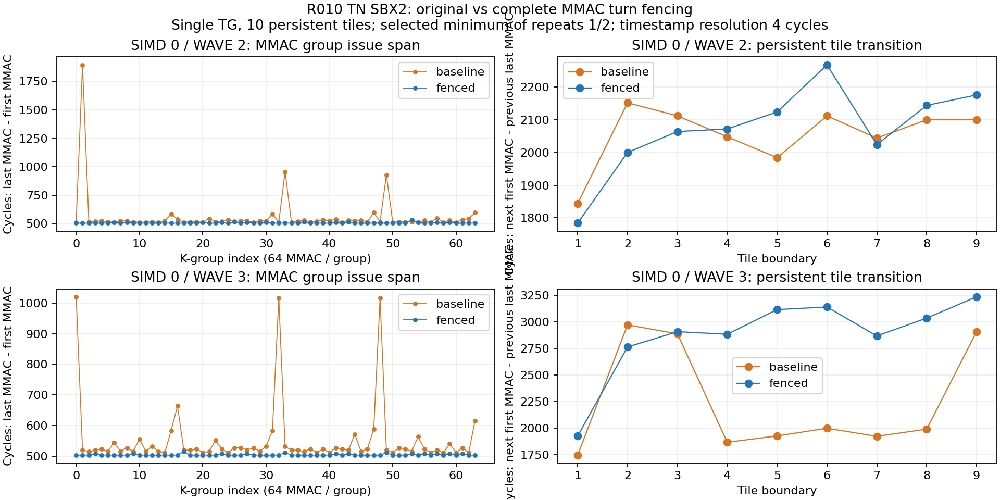

# R010 SBX2 TN / TT

Measured on 2026-11-17, node60 container `kxu_pmd_8569_fp8_20261017`, PMD 8569 / gfx946 / `GPU_CHIP=sbx2`, 2 dies × 48 CU, GC period 455 ps. M/N/K = 2560/12288/2048, FP8 E4M3FN inputs and BF16 output. A scales are FP32; B scales retain BF16 values, exactly promoted to FP32 on CPU before upload. Toolchain binaries, patches, environment and runtime topology are recorded separately for [TN](tn/record.json) and [TT](tt/record.json).

| Layout | Weight strides [N,K] | Full cold dispatch | Effective TOPS | Output validation |
|---|---|---:|---:|---|
| TN | [2048,1] | 123.455605 µs | 1043.687072 | 31,457,280 exact; guards pass |
| TT | [1,12288] | 133.084315 µs | 968.175843 | 31,457,280 exact; guards pass |

Each full result is one public-API dispatch, 96 persistent TGs × 10 output tiles, with 48 TGs completing on each die and 96 active CUs. Latency uses complete-system `gcSimCycles × 455 ps`; die times are not summed. CPU reference, scale promotion, uploads, JIT and readback are excluded. TT inputs already have their native strides before upload; kernel timing includes no transpose or repack.

## Complete MMAC turns

The original assembly placed only one MMAC between each `s_ebarrier_sync` and `s_ebarrier_arrive`; 378 of the 384 static MMAC instructions were outside the six handoff intervals. Compiler scheduling fences now keep every complete 64-instruction MMAC group inside its interval:

```text
s_ebarrier_sync → 64 × v_mmac → s_ebarrier_arrive
```

Execution barriers hand the MMAC turn between consumer partitions. A/B readiness and LDS slot lifetime continue to use their separate abarriers. The added scheduling fences are compiler constraints; they introduce no new runtime memory barrier. The fix is scoped to R010's 96-TG dispatch. [TN assembly audit](tn/mmac_turn_audit.json) and [TT assembly audit](tt/mmac_turn_audit.json) both report six complete groups and zero MMAC instructions outside the intervals. TN full latency falls 4.4623% from 129.221820 µs with the same topology, input convention and toolchain.

Single-TG trace comparison, SIMD0 (cycles from first to last issued MMAC in each group):

| Wave | Original even / odd group mean | Fenced even / odd group mean |
|---|---:|---:|
| WAVE2 | 519.65 / 589.95 | 504.90 / 505.75 |
| WAVE3 | 638.15 / 533.95 | 504.00 / 506.15 |



These means use all 160 groups from each consumer wave over ten persistent tiles. The plot shows the first 64 groups and all nine tile transitions. PERF timestamps have 4-cycle resolution. The comparison traces select the minimum of repeats 1/2, excluding repeat 0. The original trace is retained in [the previous evidence commit](https://github.com/TBodyAltra/BoltOPs/blob/e3f5b74e/docs/ops/gemm/tuning/r010/2die/tn/single_tg.perf); the comparison's original probe used the same original executable sections. [Summary data](mmac-trace-summary.json) retains the separate probe timings. MMAC group spans become nearly uniform, while persistent tile transition gaps remain; this change does not claim those gaps are eliminated.

## Native TT

TT uses an N-contiguous B matrix load with warp distribution `[2,2]`, `MlsSharedLayout` alt=0, plain MFMA operand/accumulator layout and BF16 vector stores. This layout is supported by the measured FP8 backend. Auto dispatch selects it only for the recorded precision/recipe/M/N/K/96-CU match. Other shapes and unsupported views fall back to Triton. Explicit Gluon does not copy input tensors to make them contiguous.

## Reproduce and inspect

```bash
python docs/ops/gemm/tuning/r010/2die/tn/benchmark.py \
  --record docs/ops/gemm/tuning/r010/2die/tn/record.json --output /tmp/r010-tn
python docs/ops/gemm/tuning/r010/2die/tt/benchmark.py \
  --record docs/ops/gemm/tuning/r010/2die/tt/record.json --output /tmp/r010-tt
```

Use `--compile-only` for compilation/resources, or `--single-tg-perf` for three separately validated PERF captures. Each layout includes `measurement.json`, `stats.txt.gz`, `kernel.amdgcn`, `single_tg.perf`, `perf_measurement.json` and `perf_stats.txt.gz`. PERF launches one TG with the original full MNK, output stride, `NUM_SMS=96` and `TILE_LIMIT=960`; it covers 327,680 outputs and checks uncovered output sentinels. Its timing is separate from the full-grid result. Full/profiling executable `.text` and `.rodata` match, and the embedded PERF HSACO matches the captured profiling binary.

The shared module at the implementation commit pinned in each record exactly matches the TT full-run source hash. TN was measured before the TT constexpr branches were added; compiling that module for TN produces identical `.text` and `.rodata`, documented in [binary_equivalence.json](tn/binary_equivalence.json). Both measured and implementation source hashes are retained in the TN record.

After merging the upstream R011 dual-die pipeline, compile-only validation confirms identical `.text` and `.rodata` for R010 TN, R010 TT and R011 TN against their published measured binaries. The merged source hash, section hashes and repeated regression results are retained in [merge_validation.json](merge_validation.json). Historical source/config links remain pinned to their measured implementation commits.

Regression checks on the final source: 6 passed, 1 skipped (48-CU-only case), including TN/TT routing, fallback for unrecorded shapes and sliced views, and compile-only complete-MMAC-turn checks for both layouts. Full numerical validation is recorded separately above.
